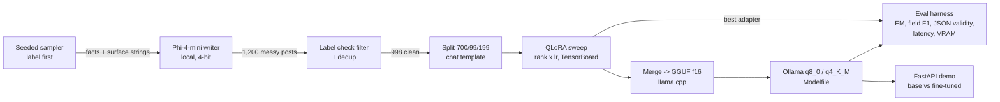

# Sieve

**Messy job posts in, strict JSON out.** A QLoRA fine-tune of Qwen2.5-1.5B-Instruct, trained on one 8 GB laptop
GPU, that turns recruiter emails, Slack pings and LinkedIn hype into one schema-valid record. It ships as a
q4_K_M GGUF in Ollama and comes with an eval harness that compares it against prompting.


## Why fine-tune, not prompt

Extraction like this looks easy until you need **conventions**, not just facts. `₹18-24 LPA` has to become
`1800000`/`2400000` INR per year. `€55.000` is fifty-five thousand. `K8s` is `kubernetes`. "Staff" means `lead`,
and a title with no marker means `mid`. A missing company is `null`, not a guess. A small model can be told all of
that in the prompt, and it still won't follow it reliably. A few hundred examples teach it.

<!-- RESULTS -->

## Pipeline



1. **Data** (`sieve/synth.py`, `sieve/generate.py`, `sieve/clean.py`). The label is sampled first; a local
   writer model wraps the facts in one of 8 styles; a filter rejects any post that drops, rewrites or contradicts
   a labelled fact. See the [dataset card](DATASET.md).
2. **Training** (`sieve/train.py`, `sieve/sweep.py`). transformers + peft + bitsandbytes. NF4 4-bit base with
   double quantisation, LoRA on all attention and MLP projections, loss on the JSON answer tokens only, paged
   8-bit AdamW, cosine schedule, gradient checkpointing, TensorBoard logs. Checkpoints every 10 steps and resumes
   automatically, because the GPU is shared.
3. **Evaluation** (`sieve/evaluate.py`, `sieve/metrics.py`). The same system prompt for every model. Greedy
   decoding. Scores: exact match (all 9 fields right), fact-level micro F1 (every non-null field, salary
   sub-field and skill is one fact), JSON parse rate, JSON-schema validity, p50/p95 single-request latency,
   batched throughput and peak VRAM.
4. **Export** (`sieve/export.py`). Merge the adapter into bf16 weights, convert to GGUF with llama.cpp's
   `convert_hf_to_gguf.py`, then `ollama create --quantize` for q8_0 and q4_K_M, using a Modelfile with the
   Qwen chat template and the system prompt.
5. **Demo** (`app/`). FastAPI and a static page. The same post goes to both models side by side, scored field
   by field when the post comes from the test set.

<!-- SWEEP -->

## Setup

Needs Python 3.11 and an NVIDIA GPU with 8 GB. The RTX 50-series (Blackwell) needs the CUDA 12.8 PyTorch wheel.

```powershell
py -3.11 -m venv .venv
.venv\Scripts\pip install torch --index-url https://download.pytorch.org/whl/cu128
.venv\Scripts\pip install -e ".[train,dev]"
```

Run the steps:

```powershell
# 1. data (the committed data/ already holds the result)
python -m sieve.generate --n 1200 --writer models/Phi-4-mini-instruct
python -m sieve.clean --raw data/raw.jsonl --out data

# 2. sweep and pick the best adapter -> runs/best/adapter
python -m sieve.sweep --epochs 1
tensorboard --logdir runs

# 3. evaluate
python -m sieve.evaluate --backend hf --mode zero --name base-zero
python -m sieve.evaluate --backend hf --mode few  --name base-few
python -m sieve.evaluate --backend hf --adapter runs/best/adapter --name finetuned

# 4. export to Ollama and evaluate the GGUF builds
python -m sieve.export --adapter runs/best/adapter --name sieve
python -m sieve.export --name sieve-base --quants q4_K_M
python -m sieve.evaluate --backend ollama --model sieve:q4_k_m --name gguf-q4_k_m
python scripts/make_table.py

# 5. demo on http://localhost:8017
$env:SIEVE_BACKEND = "ollama"; uvicorn app.server:app --port 8017
```

The base and writer models download from Hugging Face into `models/` (git-ignored). Weights, checkpoints and
GGUF files never go into git; the LoRA adapter is attached to the GitHub release.

## Tests and CI

`pytest` covers the sampler, the salary formats, the label-check filter, dedup and split, the chat format,
the metrics and the API. CI (GitHub Actions, no GPU) lints, runs the tests, runs the data pipeline on a
template-written mock dataset, and runs the eval harness against a mock model.

## Limits

- The data is synthetic, from one writer model. Real posts are longer and messier; expect lower real-world scores.
- The skill vocabulary is closed at 52 entries.
- Latency numbers come from a laptop GPU shared with other jobs, so treat them as rough.

## Licence

Code: MIT. Base model: Qwen2.5-1.5B-Instruct (Apache 2.0). Writer model: Phi-4-mini-instruct (MIT).
