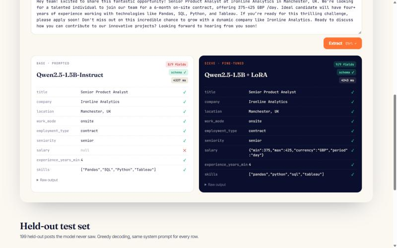
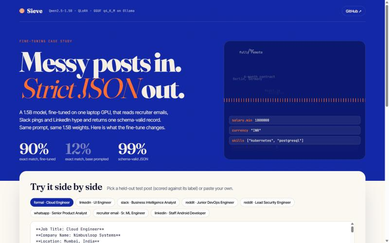
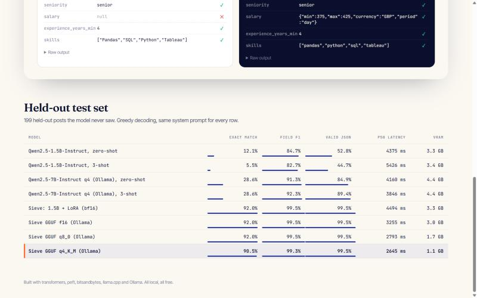
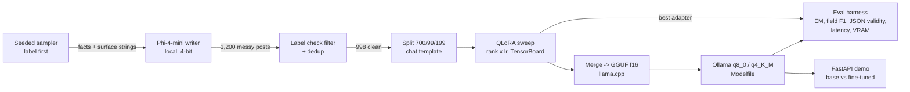
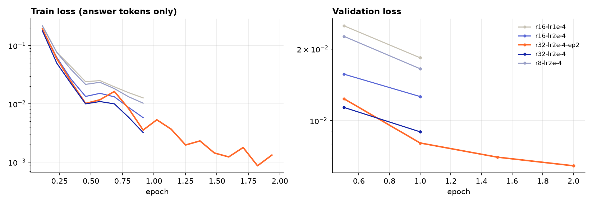

# Sieve

**Messy job posts in, strict JSON out.** A QLoRA fine-tune of Qwen2.5-1.5B-Instruct, trained on one 8 GB laptop
GPU, that turns recruiter emails, Slack pings and LinkedIn hype into one schema-valid record. It ships as a
q4_K_M GGUF in Ollama and comes with an eval harness that compares it against prompting.





## Why fine-tune, not prompt

Extraction like this looks easy until you need **conventions**, not just facts. `₹18-24 LPA` has to become
`1800000`/`2400000` INR per year. `€55.000` is fifty-five thousand. `K8s` is `kubernetes`. "Staff" means `lead`,
and a title with no marker means `mid`. A missing company is `null`, not a guess. A small model can be told all of
that in the prompt, and it still won't follow it reliably. A few hundred examples teach it.

## Results

199 held-out test posts. Same system prompt for every row, greedy decoding, no constrained decoding.

| Model | Exact match | Field F1 | Valid JSON (schema) | p50 latency | Throughput | Peak VRAM |
|---|---:|---:|---:|---:|---:|---:|
| Qwen2.5-1.5B-Instruct, zero-shot | 12.1% | 84.7% | 52.8% | 4.38 s | 1.39/s | 3.3 GB |
| Qwen2.5-1.5B-Instruct, 3-shot | 5.5% | 82.7% | 44.7% | 5.43 s | 0.75/s | 3.4 GB |
| Qwen2.5-7B-Instruct q4 (Ollama), zero-shot | 28.6% | 91.3% | 84.9% | 4.16 s | 0.25/s | 4.4 GB |
| Qwen2.5-7B-Instruct q4 (Ollama), 3-shot | 28.6% | 92.3% | 89.4% | 3.85 s | 0.26/s | 4.4 GB |
| **Sieve: 1.5B + LoRA (bf16)** | 92.0% | 99.5% | 99.5% | 4.49 s | 1.72/s | 3.3 GB |
| **Sieve GGUF f16 (Ollama)** | 92.0% | 99.5% | 99.5% | 3.26 s | 0.31/s | 3.0 GB |
| **Sieve GGUF q8_0 (Ollama)** | 92.0% | 99.5% | 99.5% | 2.79 s | 0.36/s | 1.7 GB |
| **Sieve GGUF q4_K_M (Ollama)** | 90.5% | 99.3% | 99.5% | 2.64 s | 0.38/s | 1.1 GB |

- **Fine-tuning takes exact match from 12.1% to 92.0%** on the same 1.5B weights. That beats a 5x larger
  model (Qwen2.5-7B, 28.6%) prompted with the same instructions and 3 examples.
- **Quantisation is almost free.** f16 and q8_0 GGUF in Ollama match the bf16 model on every metric. q4_K_M
  loses 1.5 points of exact match (3 posts out of 199), keeps 99.3% field F1, and needs 1.1 GB instead of 3.3 GB.
- **Few-shot hurts the small base model** (12.1% → 5.5%). The extra ~870 tokens of examples make it copy
  surface forms ("permanent", "null" as a string) more often, not less.
- The prompted models fail on exactly the conventions: `seniority` (55% → 99%), `salary` normalisation
  (59% → 100%) and canonical `skills` (47% → 95%).

<details><summary>Per-field accuracy</summary>

| Field accuracy | base-zero | base-few | qwen7b-zero | qwen7b-few | finetuned | gguf-f16 | gguf-q8_0 | gguf-q4_k_m |
|---|---:|---:|---:|---:|---:|---:|---:|---:|
| `title` | 97.5% | 97.0% | 99.0% | 98.5% | 98.5% | 98.5% | 98.5% | 98.5% |
| `company` | 83.4% | 87.4% | 97.5% | 96.5% | 100.0% | 99.5% | 99.5% | 97.5% |
| `location` | 97.5% | 97.0% | 98.5% | 100.0% | 100.0% | 100.0% | 100.0% | 100.0% |
| `work_mode` | 82.4% | 80.4% | 92.5% | 87.4% | 99.0% | 99.0% | 99.0% | 99.0% |
| `employment_type` | 78.9% | 69.8% | 87.4% | 86.9% | 99.5% | 100.0% | 100.0% | 100.0% |
| `seniority` | 55.3% | 55.3% | 68.8% | 79.4% | 99.0% | 99.0% | 99.0% | 99.0% |
| `salary` | 59.3% | 66.3% | 91.5% | 92.0% | 100.0% | 100.0% | 100.0% | 99.5% |
| `experience_years_min` | 98.5% | 98.0% | 100.0% | 100.0% | 100.0% | 100.0% | 100.0% | 100.0% |
| `skills` | 47.2% | 40.2% | 50.8% | 55.3% | 95.0% | 95.0% | 95.0% | 95.5% |

</details>

Exact match means all 9 fields equal the label. Field F1 is micro F1 over atomic facts (each non-null field,
salary sub-field and skill). Valid JSON means the reply parses *and* passes the JSON Schema in
`sieve/schema.py`. Latency is p50 over 20 single requests after a warm-up, on an RTX 5050 Laptop GPU
that other jobs were also using. VRAM is peak allocated memory for the transformers rows and resident model size
for the Ollama rows.



## Pipeline



1. **Data** (`sieve/synth.py`, `sieve/generate.py`, `sieve/clean.py`). The label is sampled first; a local
   writer model wraps the facts in one of 8 styles; a filter rejects any post that drops, rewrites or contradicts
   a labelled fact. See the [dataset card](DATASET.md).
2. **Training** (`sieve/train.py`, `sieve/sweep.py`). transformers + peft + bitsandbytes. NF4 4-bit base with
   double quantisation, LoRA on all attention and MLP projections, loss on the JSON answer tokens only, paged
   8-bit AdamW, cosine schedule, gradient checkpointing, TensorBoard logs. Checkpoints every 10 steps and resumes
   automatically, because the GPU is shared.
3. **Evaluation** (`sieve/evaluate.py`, `sieve/metrics.py`). The same system prompt for every model. Greedy
   decoding. Scores: exact match (all 9 fields right), fact-level micro F1 (every non-null field, salary
   sub-field and skill is one fact), JSON parse rate, JSON-schema validity, p50/p95 single-request latency,
   batched throughput and peak VRAM.
4. **Export** (`sieve/export.py`). Merge the adapter into bf16 weights, convert to GGUF with llama.cpp's
   `convert_hf_to_gguf.py`, then `ollama create --quantize` for q8_0 and q4_K_M, using a Modelfile with the
   Qwen chat template and the system prompt.
5. **Demo** (`app/`). FastAPI and a static page. The same post goes to both models side by side, scored field
   by field when the post comes from the test set.

## Hyperparameter sweep

LoRA rank x learning rate, 1 epoch each on the 700 training posts, then the winner for 2 epochs. Scored on the
99-post validation split. Alpha = 2 x rank, dropout 0.05, effective batch 16, max length 768.

| Run | LoRA rank | LR | Epochs | Trainable params | Val loss | Val exact match | Val field F1 | Val valid JSON | Peak train VRAM |
|---|---:|---:|---:|---:|---:|---:|---:|---:|---:|
| r16-lr1e-4 | 16 | 1e-04 | 1 | 18.5M | 0.0184 | 53.5% | 96.3% | 94.9% | 2.53 GB |
| r8-lr2e-4 | 8 | 2e-04 | 1 | 9.2M | 0.0165 | 60.6% | 97.1% | 94.9% | 2.47 GB |
| r16-lr2e-4 | 16 | 2e-04 | 1 | 18.5M | 0.0126 | 74.7% | 98.3% | 97.0% | 2.53 GB |
| r32-lr2e-4 | 32 | 2e-04 | 1 | 36.9M | 0.0090 | 76.8% | 98.6% | 100.0% | 2.71 GB |
| r32-lr2e-4-ep2 | 32 | 2e-04 | 2 | 36.9M | 0.0065 | 91.9% | 99.5% | 99.0% | 2.71 GB |



Higher rank and the higher learning rate both helped, and the second epoch was worth another 15 points of
exact match. Training peaks at **2.7 GB of VRAM**: the 1.5B base sits in NF4, and batch 1 x 16 accumulation
keeps the 151k-vocabulary logits small. On the shared GPU a 1-epoch run took about 11 minutes and the 2-epoch run 34.
TensorBoard logs are written to `runs/<name>/tb`.

## Setup

Needs Python 3.11 and an NVIDIA GPU with 8 GB. The RTX 50-series (Blackwell) needs the CUDA 12.8 PyTorch wheel.

```powershell
py -3.11 -m venv .venv
.venv\Scripts\pip install torch --index-url https://download.pytorch.org/whl/cu128
.venv\Scripts\pip install -e ".[train,dev]"
```

Run the steps:

```powershell
# 1. data (the committed data/ already holds the result)
python -m sieve.generate --n 1200 --writer models/Phi-4-mini-instruct
python -m sieve.clean --raw data/raw.jsonl --out data

# 2. sweep and pick the best adapter -> runs/best/adapter
python -m sieve.sweep --epochs 1
tensorboard --logdir runs

# 3. evaluate
python -m sieve.evaluate --backend hf --mode zero --name base-zero
python -m sieve.evaluate --backend hf --mode few  --name base-few
python -m sieve.evaluate --backend hf --adapter runs/best/adapter --name finetuned

# 4. export to Ollama and evaluate the GGUF builds
python -m sieve.export --adapter runs/best/adapter --name sieve
python -m sieve.export --name sieve-base --quants q4_K_M
python -m sieve.evaluate --backend ollama --model sieve:q4_k_m --name gguf-q4_k_m
python scripts/make_table.py

# 5. demo on http://localhost:8017
$env:SIEVE_BACKEND = "ollama"; uvicorn app.server:app --port 8017
```

The base and writer models download from Hugging Face into `models/` (git-ignored). Weights, checkpoints and
GGUF files never go into git; the LoRA adapter (138 MB) is attached to the [v0.1.0 release](https://github.com/alok-kul5/sieve/releases/tag/v0.1.0).

## Tests and CI

`pytest` covers the sampler, the salary formats, the label-check filter, dedup and split, the chat format,
the metrics and the API. CI (GitHub Actions, no GPU) lints, runs the tests, runs the data pipeline on a
template-written mock dataset, and runs the eval harness against a mock model.

## Limits

- The data is synthetic, from one writer model. Real posts are longer and messier; expect lower real-world scores.
- The skill vocabulary is closed at 52 entries.
- Latency numbers come from a laptop GPU shared with other jobs, so treat them as rough.

## Licence

Code: MIT. Base model: Qwen2.5-1.5B-Instruct (Apache 2.0). Writer model: Phi-4-mini-instruct (MIT).
